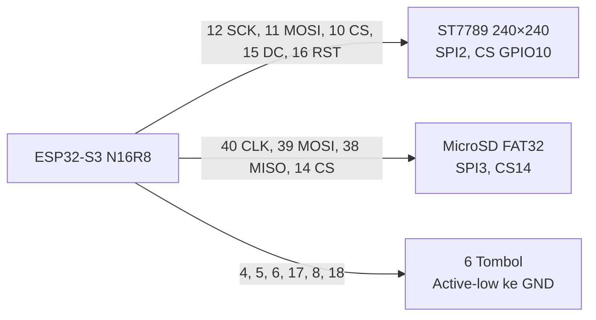

# Flipper ESP32-S3 DIY 240

**Adaptasi hardware untuk ESP32-S3 N16R8, ST7789 240×240 8-pin, microSD SPI3, dan keypad 6 tombol.**

> [!IMPORTANT]
> **Status: firmware berhasil dibangun dan diverifikasi melalui GitHub Actions; belum diuji pada ESP32-S3 fisik.**
> Paket firmware untuk flashing pertama telah dihasilkan dengan empat image, checksum SHA256 dan offset yang telah diverifikasi. Keberhasilan flashing dan fungsi modul tetap harus diuji di board fisik. Firmware ini berbasis kode [Sor3nt/Flipper-Zero-ESP32-Port](https://github.com/Sor3nt/Flipper-Zero-ESP32-Port) pada commit tetap `e6ec11972a8e025d7ab686a6ef3016cf52360834` (14 November 2026). Versi firmware upstream dalam source: `2.0.0`.

Proyek ini adalah **repositori integrasi/patch**, bukan salinan penuh source upstream. Saat build, script mengambil source tepat pada commit di atas, menerapkan perubahan yang dapat direproduksi, lalu menghasilkan image untuk di-flash menggunakan ESP-IDF. Dengan cara ini, asal source tetap jelas dan repo ini tidak menyimpan ulang ribuan file/binary aplikasi pihak ketiga.

## Web Flasher — Windows, Linux, macOS, Android

**[Buka DIY240 Web Flasher](https://diy240.vercel.app)**

**[Firmware Flipper 1.5.1 ESP32 preview untuk ST7789 240x240](https://diy240.vercel.app/flipper-st7789-151-preview/)** — build eksperimen, bukan firmware resmi lengkap; periksa profil hardware sebelum flash.

Situs menyediakan flashing USB berbasis [ESP Web Tools](https://esphome.github.io/esp-web-tools/) pada browser yang kompatibel, file merged `.bin`, perintah esptool manual, diagram wiring, serta panduan Windows/Linux/macOS/Android/iOS.

- Profil firmware: **ESP32-S3 N16R8**, ST7789 240×240 dengan CS GPIO10, microSD SPI3, enam tombol.
- Firmware web dibangun dari empat image pada [build CI sukses](https://github.com/gungsss/flipper-esp32s3-diy240/actions/runs/43889135916), digabung menggunakan `esptool` dan diverifikasi checksum/offset.
- **Windows**: utamakan Chrome atau Edge desktop. Linux dan macOS didukung pada browser kompatibel.
- **Android**: memerlukan browser/perangkat yang mendukung USB Serial/OTG; dukungan tidak universal.
- **iOS**: tidak dapat melakukan flashing USB langsung melalui halaman web, tetapi panduan tetap dapat dibaca.
- Build sukses dan file tersedia **tidak menjamin semua fungsi hardware sudah diuji**. Pastikan wiring dan cadangkan data sebelum flashing.

Source situs dan dokumentasi: [`web/`](web/README.md).

## Perangkat target

| Komponen | Konfigurasi |
|---|---|
| MCU | ESP32-S3 **N16R8** (flash 16 MB, PSRAM 8 MB) |
| Display | TFT **ST7789 240×240 8-pin, CS GPIO10**, SPI2 |
| Storage | microSD reader **SPI 6 pin 3,3 V**, SPI3, FAT32 |
| Navigasi | PCB `COM / UP / DWN / LET / RHT / MID / SET / RST`; **6 tombol** untuk menu |
| Power | USB dari board; sambungan modul menggunakan **3V3 & GND bersama** |
| Periferal belum tersedia | CC1101, nRF24, PN532/NFC, IR TX/RX, LF RFID |

## Mulai dari sini

1. **[Wiring lengkap](docs/HARDWARE.md)** — susunan GPIO, tegangan, keypad, backlight, checklist sebelum power-on.
2. **[Flash di Windows (utama)](docs/INSTALL_WINDOWS.md)** — cara mengunduh firmware hasil build, memasang `esptool`, menemukan COM port, dan flashing.
3. **[Flash Windows, Linux, atau macOS](docs/FLASH.md)** — cara flash lintas platform dan pemulihan.
4. **[Build di macOS](docs/INSTALL_MAC.md)** — untuk developer yang ingin kompilasi sendiri.
5. **[Penggunaan pertama](docs/FIRST_BOOT.md)** — konfigurasi SD, tombol, Wi-Fi, BLE, validasi fitur.
6. **[Troubleshooting](docs/TROUBLESHOOTING.md)** — driver Windows, COM port, layar putih/hitam, panel offset, SD, boot loop.

> [!CAUTION]
> Pin CS LCD pada modul di foto wajib tersambung ke **GPIO10**. LCD memakai **SPI2** dan microSD memakai **SPI3 terpisah**. Sambungan BLK/backlight berbeda antar modul; jangan mengalirkan arus LED secara langsung dari GPIO ESP32.

## Windows — jalur utama untuk pengguna

Jika GitHub Actions sudah berhasil menghasilkan firmware untuk DIY240, pengguna Windows cukup memasang Python dan `esptool`, lalu flash memakai `flash_windows.ps1` dari artifact. **Tidak perlu Mac atau instalasi ESP-IDF.** [Ikuti panduan Windows lengkap](docs/INSTALL_WINDOWS.md).

> **Build firmware sudah berhasil:** [GitHub Actions — verified DIY240 firmware](https://github.com/gungsss/flipper-esp32s3-diy240/actions/runs/43889135916). Gunakan artifact dari run ini atau build lebih baru yang sukses, bukan ZIP awal yang belum menyertakan OTA initializer. [Catatan pengujian](docs/TEST_REPORT.md).

## Build lokal untuk developer (macOS)

Memerlukan Git, Python 3, serta **ESP-IDF v5.4.1** yang sudah terpasang di `~/esp/esp-idf` (lihat [panduan instalasi](docs/INSTALL_MAC.md)).

```bash
git clone https://github.com/gungsss/flipper-esp32s3-diy240.git
cd flipper-esp32s3-diy240
./scripts/build_local.sh
ls .work/upstream/build_diy/furi_esp32.bin
ls /dev/cu.usb*
./scripts/flash_local.sh /dev/cu.usbmodemXXXX --monitor
```

Repositori integrasi: [gungsss/flipper-esp32s3-diy240](https://github.com/gungsss/flipper-esp32s3-diy240).

### Build otomatis dari GitHub Actions

Unduh artifact `flipper-diy-s3-n16r8-st7789-240` dari [build sukses](https://github.com/gungsss/flipper-esp32s3-diy240/actions/runs/43889135916). ZIP berisi `furi_esp32.bin`, bootloader, tabel partisi, `ota_data_initial.bin`, `BUILD_INFO.json`, `flash_windows.ps1` dan `flash_macos_linux.sh`. Di Windows gunakan `flash_windows.ps1` dari PowerShell; Linux/macOS gunakan `flash_macos_linux.sh`. Prosedur lengkap: [FLASH.md](docs/FLASH.md). Artifact dari workflow yang *gagal* tidak boleh dianggap siap flash.


### Status build otomatis dan jalur alternatif Windows

**GitHub Actions kembali berjalan normal setelah pembatasan akun diselesaikan.** Build firmware berhasil pada [run #43889135916](https://github.com/gungsss/flipper-esp32s3-diy240/actions/runs/43889135916) dan menghasilkan artifact ZIP dengan empat image terverifikasi. Catatan gangguan sebelumnya tersimpan di [diagnostik CI](docs/CI_RUNNER_DIAGNOSTICS.md) dan [issue yang sudah ditutup](https://github.com/gungsss/flipper-esp32s3-diy240/issues/1).

Jika tidak ingin bergantung pada runner GitHub, pengguna Windows dapat mencoba [build melalui WSL2 Ubuntu](docs/BUILD_WINDOWS_WSL.md), lalu flash hasilnya menggunakan PowerShell Windows. **Alur ini belum tervalidasi pada hardware**.

## Uji rangkaian langsung dari Windows (tanpa GitHub Actions)

Untuk menguji TFT, microSD dan enam tombol sebelum full firmware tersedia, tersedia [sketch uji hardware Arduino IDE](docs/HARDWARE_SMOKE_TEST_WINDOWS.md) pada `examples/hardware-smoke-test/`. **Ini firmware diagnostik, bukan Flipper**. Hardware dan build penuh masih perlu diverifikasi.

## Wiring singkat



Tabel pin dan detail rangkaian: [docs/HARDWARE.md](docs/HARDWARE.md).

## Batasan yang perlu diketahui

- **ESP32-S3 bukan Flipper Zero asli**. Aplikasi FAP ARM dari Flipper asli tidak otomatis kompatibel.
- UI Flipper asli berukuran 128×64, diperbesar ke layar 240×240 dengan aspek rasio dipertahankan; ada ruang kosong di bagian atas-bawah.
- Tanpa CC1101/PN532/NRF24/IR, fitur yang memerlukan periferal itu tidak ada; menambah modul nantinya memerlukan konfigurasi hardware baru.
- Wi-Fi dan BLE pada port ini tidak berjalan bersamaan dalam beberapa mode.
- Sebagian aplikasi yang menggambar langsung pada dimensi 320×170 mungkin tidak cocok pada panel 240×240.
- **OTA Wi-Fi upstream menonaktifkan pemeriksaan sertifikat server dalam konfigurasi yang diperiksa**. Untuk perangkat ini, **gunakan flash USB lokal**; jangan menganggap OTA upstream sebagai mekanisme pembaruan aman.
- Repositori ini belum mengklaim secure boot, flash encryption, atau audit semua komponen/upstream.

Detail: [FEATURES.md](docs/FEATURES.md), [SECURITY.md](docs/SECURITY.md), [TROUBLESHOOTING.md](docs/TROUBLESHOOTING.md).

## Struktur proyek

```text
.github/workflows/build.yml   # build otomatis, upload artifact firmware
patch/                        # patch source berbasis commit upstream + pinout
scripts/fetch_upstream.sh     # ambil source upstream terpin
scripts/build_local.sh       # build lokal via ESP-IDF 5.4.1
scripts/flash_local.sh       # flash setelah build, dengan konfirmasi
scripts/package_artifacts.py # validasi offset dan paket image
scripts/flash_package.sh     # digunakan di dalam artifact CI
tests/                        # smoke tests source patch
docs/                        # panduan wiring, instalasi, flash, troubleshooting
```

## Asal proyek dan kredit

- Port firmware original: **Sor3nt**, [GitHub resmi](https://github.com/Sor3nt/Flipper-Zero-ESP32-Port).
- Arsitektur original Flipper Zero: [Flipper Devices](https://github.com/flipperdevices/flipperzero-firmware).
- Integrasi hardware + dokumentasi spesifik N16R8/ST7789 240×240: repositori ini.
- Kode upstream dan dependensi membawa ketentuan hak cipta/lisensinya masing-masing; proyek ini **tidak mengklaim kepemilikan source upstream**. Periksa ketentuan upstream sebelum mendistribusikan binary yang dibangun.

Untuk proses kontribusi, pembaruan versi upstream dan catatan pengujian, baca [DEVELOPMENT.md](docs/DEVELOPMENT.md) dan [TEST_REPORT.md](docs/TEST_REPORT.md).
